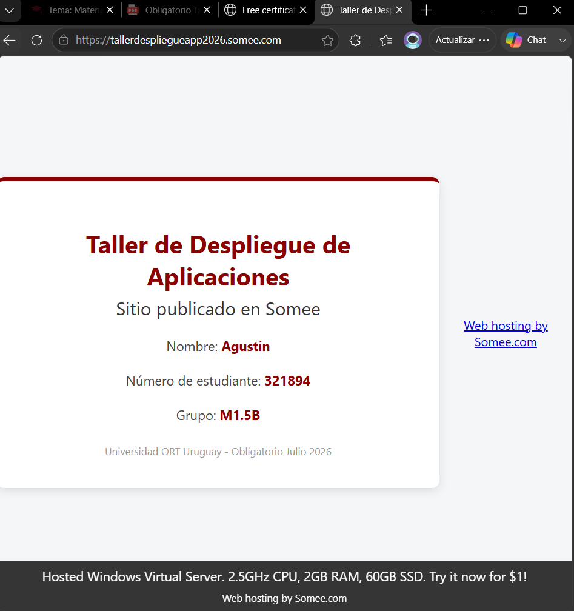
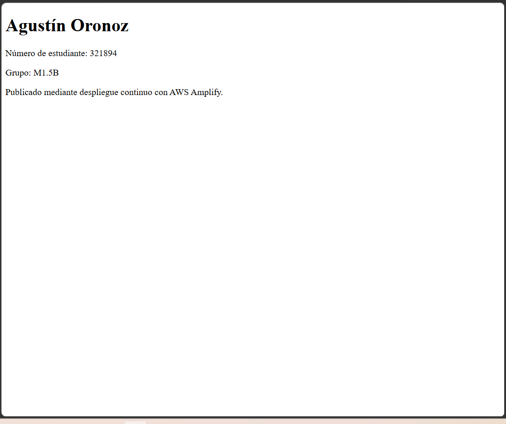
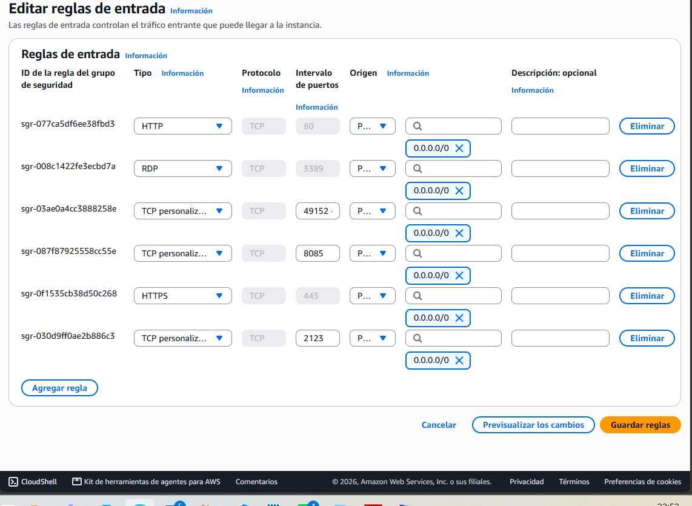
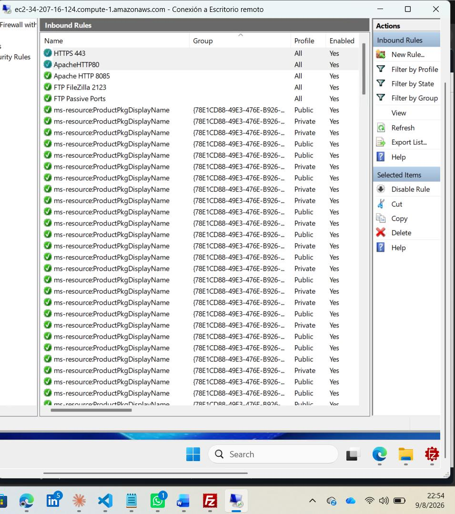
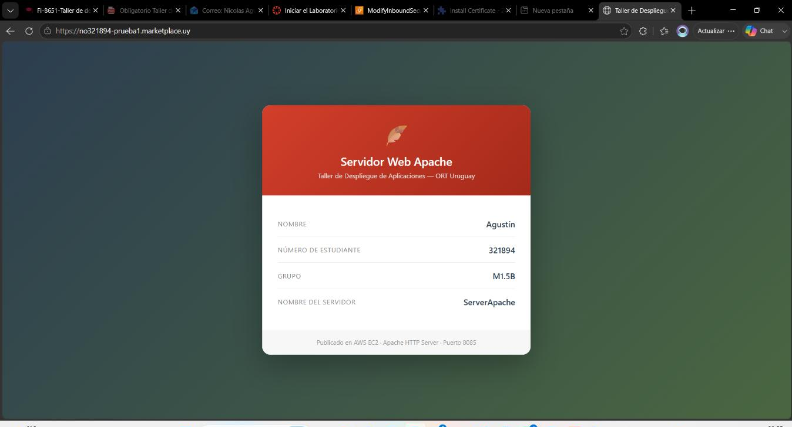
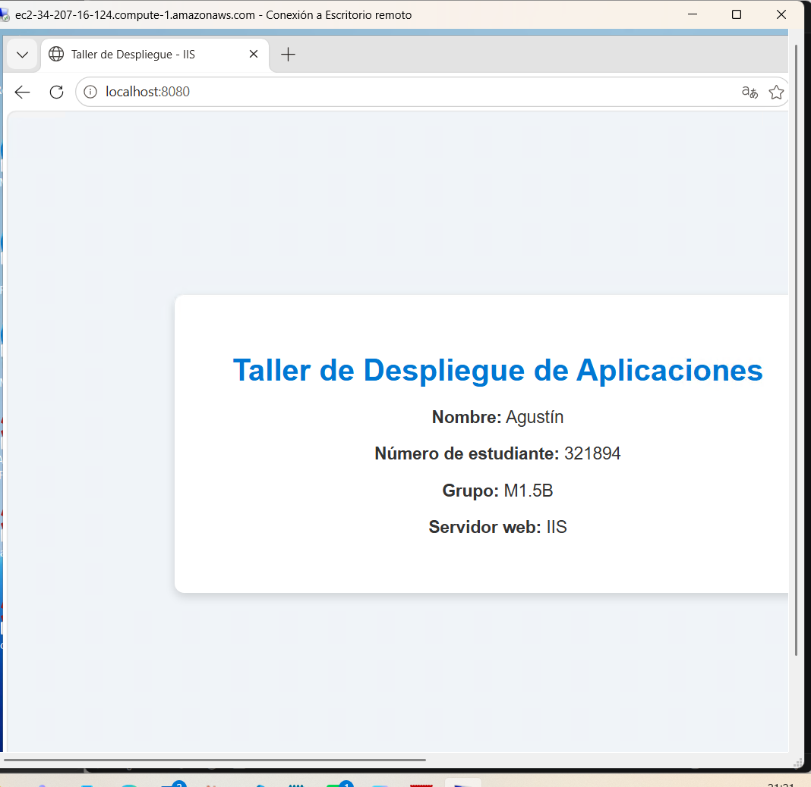

# Despliegue de sitios web en AWS, Somee y AWS Amplify

Obligatorio individual del **Taller de Despliegue de Aplicaciones** (Universidad ORT Uruguay, julio 2026). Aprobado con 87/100.

El objetivo fue publicar el mismo tipo de sitio en tres entornos distintos y dejarlo accesible desde internet: un hosting tradicional, un servicio de despliegue continuo y servidores propios en la nube configurados a mano. Todo el proceso quedó documentado paso a paso en una Memoria de Implementación de 100 páginas con capturas y tablas de testing.

> El entorno corría en el laboratorio de AWS Academy, que se apaga al terminar el curso, por lo que los servidores ya no están en línea. Las capturas de esta carpeta muestran cada servicio funcionando durante la entrega.

## Qué hice

| Entorno | Tarea | Resultado |
|---|---|---|
| **Somee** (hosting tradicional) | Creé el sitio, lo publiqué con File Manager y emití un certificado SSL gratuito | Sitio accesible por HTTPS |
| **AWS Amplify** | Creé el repositorio en GitHub, lo conecté a Amplify y configuré el despliegue continuo desde la rama `main` | Sitio publicado automáticamente desde el repositorio |
| **AWS EC2 – Apache** | Lancé una instancia Windows Server 2025 (t3.medium), le asigné una IP elástica fija e instalé Apache como servicio | Sitio en el puerto 8085 |
| **AWS EC2 – FTP** | Instalé FileZilla Server con FTP explícito sobre TLS y modo pasivo | Publicación remota de archivos al sitio |
| **Dominio + HTTPS** | Registré un subdominio con registro A apuntando a la IP elástica, validé la propiedad en ZeroSSL y configuré SSL en Apache | Sitio en `https://` con candado y sin advertencias |
| **AWS EC2 – IIS** | Instalé el rol Web Server (IIS), eliminé el sitio por defecto y creé un sitio nuevo; agregué un segundo listener FTP | Sitio IIS en el puerto 8080 y FTP propio en el 2124 |

## Arquitectura

```
                     ┌─────────────────────────────┐
                     │          Internet           │
                     └──────────────┬──────────────┘
          ┌─────────────────────────┼──────────────────────────┐
          │                         │                          │
 ┌────────▼─────────┐     ┌─────────▼──────────┐   ┌───────────▼─────────────────────────┐
 │ Somee            │     │ AWS Amplify        │   │ AWS EC2 · Windows Server 2025       │
 │ HTTPS (SSL free) │     │ CI/CD desde GitHub │   │ IP elástica + Security Group        │
 └──────────────────┘     │ rama main          │   │ Firewall de Windows                 │
                          └────────────────────┘   │                                     │
                                                   │  Apache 2.4 ── :8085  HTTP          │
                                                   │            └── :443   HTTPS ZeroSSL │
                                                   │  IIS 10   ──── :8080  HTTP          │
                                                   │  FileZilla Server                   │
                                                   │     ├── :2123 FTP → carpeta Apache  │
                                                   │     └── :2124 FTP → carpeta IIS     │
                                                   │  RDP ───────── :3389  administración│
                                                   └─────────────────────────────────────┘
```

## Puertos abiertos

Cada puerto se abrió en **dos capas**: en el Security Group de AWS (firewall de red) y en el Firewall de Windows (firewall del host). Si falta una de las dos, el servicio no responde desde afuera.

| Puerto | Protocolo | Servicio |
|---|---|---|
| 3389 | TCP | Escritorio remoto (RDP) |
| 80 | TCP | HTTP, usado para la validación de ZeroSSL |
| 443 | TCP | HTTPS del sitio Apache |
| 8085 | TCP | Sitio Apache |
| 8080 | TCP | Sitio IIS |
| 2123 | TCP | FTP del sitio Apache |
| 2124 | TCP | FTP del sitio IIS |
| 49152–65534 | TCP | FTP en modo pasivo |

## Problemas que resolví

- **El FTP conectaba pero no listaba archivos desde afuera.** El modo pasivo le devolvía al cliente la IP privada de la instancia, que está detrás del NAT de AWS. Lo resolví configurando la IP pública en *Passive mode → Public IP* de FileZilla Server y abriendo el rango de puertos pasivos en las dos capas de firewall.
- **ZeroSSL no validaba el dominio.** La validación por archivo usa HTTP estándar en el puerto 80, y Apache solo escuchaba en el 8085. Agregué `Listen 80`, abrí el puerto y volví a subir el archivo de validación a `/.well-known/pki-validation/`. Además, al subirlo por FTP quedó con el sufijo ` (1)` en el nombre, y hubo que renombrarlo.
- **Apache no arrancaba después de instalar el certificado** (error `AH00526`, no encontraba `server.crt`). Windows tenía ocultas las extensiones y los archivos habían quedado como `server.crt.crt`. Los renombré y validé la configuración con `httpd.exe -t` antes de reiniciar.
- **El sitio HTTPS no cargaba desde internet.** Faltaba la regla del puerto 443 en el Security Group de AWS.
- **Dos servidores web y dos FTP en la misma máquina.** Separé cada servicio por puerto (8085 / 8080 y 2123 / 2124) y le di a cada usuario FTP acceso solo a la carpeta de su sitio.

## Testing

| Prueba | Resultado |
|---|---|
| Sitio IIS en `localhost:8080` desde la VM | OK |
| Sitio IIS en el puerto 8080 desde una PC externa | OK |
| Conexión FTP con TLS al sitio IIS (puerto 2124) | OK |
| Sitio Apache sigue activo después de instalar IIS (puerto 8085) | OK |
| FTP de Apache sigue activo (puerto 2123) | OK |
| Sitio Apache por HTTPS con dominio propio, sin advertencias | OK |
| Sitio de Somee por HTTPS | OK |
| Sitio de Amplify publicado desde la rama `main` | OK |

## Capturas

| | |
|---|---|
|  Somee con HTTPS |  Sitio publicado por Amplify |
|  Reglas de entrada del Security Group |  Reglas del Firewall de Windows |
|  Apache con HTTPS y dominio propio |  Sitio en IIS |

## Contenido de esta carpeta

- `sitios/amplify/index.html`: el sitio publicado con despliegue continuo.
- `config/apache/cambios-httpd.conf`: los cambios que hice sobre la configuración de Apache para el puerto propio y SSL.
- `capturas/`: evidencia de cada servicio funcionando.

Las credenciales de acceso se entregaron solo al docente y no forman parte de este repositorio.

## Tecnologías

AWS EC2 · IP elástica · Security Groups · AWS Amplify · Windows Server 2025 · Apache 2.4 · IIS 10 · FileZilla Server · FTP sobre TLS · DNS (registro A) · ZeroSSL · Somee · Git / GitHub

---
**Agustín Oronoz** · [github.com/AgustinOronoz](https://github.com/AgustinOronoz)
